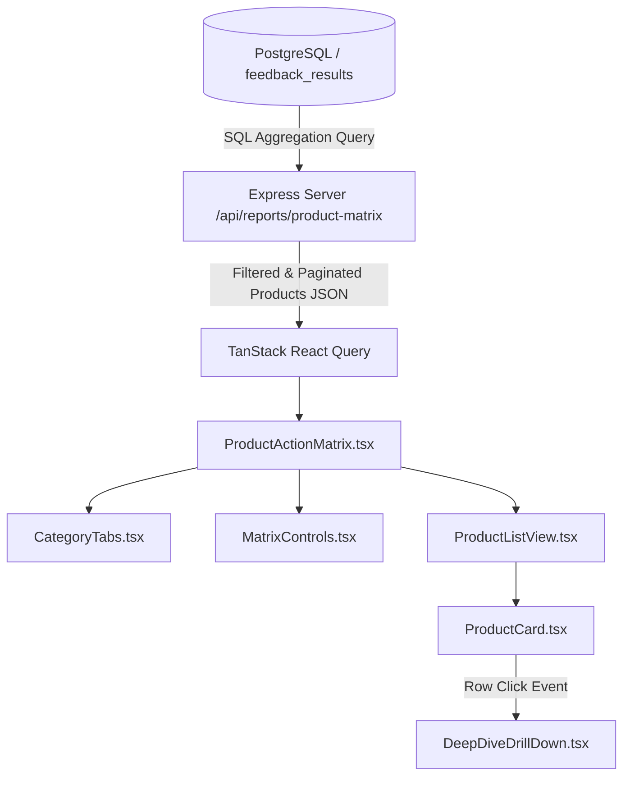

# Product Action Matrix — Feature & Business Logic Documentation

## 1. Executive Summary

The **Product Action Matrix** is an analytical triage component on the **Retail Manager Analysis Reports** page (`/dashboard/reports`). It transforms thousands of unstructured customer reviews and aspect-based sentiment data into a clear, tabular prioritization framework.

Rather than reading through isolated reviews or relying on misleading general star averages, retail managers use this matrix to answer three core operational questions:
1. **Which products are our brand champions?** (Double down on marketing, maintain inventory, benchmark quality)
2. **Which products are damaging customer trust or driving returns?** (Immediate intervention, vendor review, or recall)
3. **Which products have split or uncertain customer sentiment?** (Investigate specific friction points or collect more feedback)

```
+-----------------------------------------------------------------------------------------------------------------------+
|                                              PRODUCT ACTION MATRIX                                                    |
+-----------------------------------------------------------------------------------------------------------------------+
|  [ ⚠️ Needs Attention (4) ]   [ 🌟 Star Products (12) ]   [ 🔄 Mixed Reviews (7) ]                                    |
|                                                                                                                       |
|  [ 🔍 Search products by name... ]                  [ Sort: Volume (Asc) ▾ ]   [ Min. Volume: 5 ▾ ]                   |
+-----------------------------------------------------------------------------------------------------------------------+
|  #   | Product Name                          | Sentiment Breakdown        | Reviews | Net Score | Action              |
|  ----+---------------------------------------+----------------------------+---------+-----------+-------------------  |
|  1   | 🔴 Ergonomic Mesh Office Chair        | 🟢 26% Pos   🔴 54% Neg    |      89 |       -28 | [ Filter ]          |
|  2   | 🔴 Ultra-Thin Gaming Mouse            | 🟢 30% Pos   🔴 50% Neg    |     112 |       -20 | [ Filter ]          |
|  3   | 🔴 USB-C Multiport Adapter 7-in-1     | 🟢 35% Pos   🔴 45% Neg    |      48 |       -10 | [ Filter ]          |
|  4   | 🔴 Wireless Mechanical Keyboard (RGB) | 🟢 38% Pos   🔴 40% Neg    |     145 |        -2 | [ Filter ]          |
|  ... | ...                                   | ...                        |     ... |       ... | ...                 |
|                                                                                                                       |
|  Showing 1 – 10 of 23 products                                                     [ < ]  [ 1 ]  [ 2 ]  [ 3 ]  [ > ]  |
+-----------------------------------------------------------------------------------------------------------------------+
```

---

## 2. Architecture & Data Flow

The Product Action Matrix operates via a server-driven architecture optimized for speed, accurate pagination, and reactive filtering.



---

## 3. Product Classification Rules & Thresholds

The matrix classifies products into three distinct operational buckets according to predefined mathematical thresholds (`PRODUCT_MATRIX_CONFIG`):

```typescript
export const PRODUCT_MATRIX_CONFIG = {
  star: {
    minPositivePct: 75, // Must have >= 75% positive reviews
    maxNegativePct: 15, // Must have <= 15% negative reviews
  },
  needsAttention: {
    minNegativePct: 30, // Negative reviews >= 30% OR negativePct > positivePct
  },
  minVolumeForClassification: 5, // Minimum reviews required for high-confidence classification
};
```

### Classification Algorithm

```typescript
function classifyProduct(p: { positivePct: number; negativePct: number; total: number }): "star" | "needs_attention" | "mixed" {
  const { positivePct, negativePct, total } = p;

  // 1. Guard against low sample bias (< 5 reviews default to mixed)
  if (total < PRODUCT_MATRIX_CONFIG.minVolumeForClassification) {
    return "mixed";
  }

  // 2. Star Product Criteria
  if (positivePct >= PRODUCT_MATRIX_CONFIG.star.minPositivePct && 
      negativePct <= PRODUCT_MATRIX_CONFIG.star.maxNegativePct) {
    return "star";
  }

  // 3. Needs Attention Criteria
  if (negativePct >= PRODUCT_MATRIX_CONFIG.needsAttention.minNegativePct || 
      negativePct > positivePct) {
    return "needs_attention";
  }

  // 4. Fallback: Mixed / Polarized / Low Confidence
  return "mixed";
}
```

---

## 4. Scoring Model: Net Sentiment Score

Each product is evaluated with a **Net Sentiment Score**:

$$\text{Net Sentiment Score} = \text{Positive Percentage} - \text{Negative Percentage}$$

- **Range:** `-100` to `+100`
- **Color Coding:**
  - $\ge +40$: **Emerald Green** (`bg-emerald-500`, high customer delight)
  - $+10$ to $+39$: **Amber Yellow** (`bg-amber-400`, moderate satisfaction)
  - $< +10$: **Rose Red** (`bg-rose-500`, critical complaint density)

---

## 5. Controls, Sorting & Tabular Layout

1. **Tab Navigation (Category Tabs):**
   - Direct header integration: *Needs Attention*, *Star Products*, *Mixed Reviews*.
   - Each tab features a live count badge indicating how many items match the current minimum volume and search criteria.

2. **Ascending Multi-Criteria Sorting:**
   - **Sort: Volume (Asc):** Ranks products from lowest review count to highest.
   - **Sort: Net Score (Asc):** Ranks products from most negative net sentiment to most positive.
   - **Sort: Positive % (Asc):** Ranks products from lowest positive review proportion to highest.
   - **Sort: Negative % (Asc):** Ranks products from lowest complaint percentage to highest.

3. **Tabular Row Presentation:**
   - **`#` Column:** Sequential numbering calculated as `(page - 1) * pageSize + index + 1`.
   - **Product Name:** Product title with category color indicator bar and optional rating pill.
   - **Sentiment Breakdown:** Color-coded `🟢 Pos %` and `🔴 Neg %` values.
   - **Reviews:** Mono-spaced total review count.
   - **Net Score:** Color badge showing net sentiment polarity.
   - **Action:** Interactive selection row that cross-filters the **Deep Dive Drill-Down** section.

4. **Pagination (10 Rows Per Page):**
   - Configured with `pageSize = 10` to ensure the entire table fits neatly within standard monitor viewports without vertical overflow.

