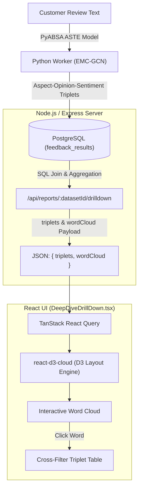

# Aspect-Opinion Word Cloud — Feature & Technical Architecture

## 1. Executive Summary

The **Aspect-Opinion Word Cloud** is an interactive visual analytics component featured in the **Deep Dive Drill-Down** section of the **Retail Manager Analysis Reports** (`/dashboard/reports`). 

Rather than generating a generic word frequency cloud of all raw review text (which often clutters the screen with uninformative stop words, filler verbs, or pronouns), this feature visualizes **AI-extracted opinion keywords**, categorized by sentiment polarity and sized proportionally to how often retail customers used them.

```
+---------------------------------------------------------------------------------------------------------+
|                                    DEEP DIVE DRILL-DOWN                                                 |
+---------------------------------------------------------------------------------------------------------+
|  Product: [ Wireless Headphones ▾ ]   Aspect: [ Sound Quality ▾ ]   Sentiment: [ All Polarities ▾ ]     |
+---------------------------------------------------------------------------------------------------------+
|                                                   |                                                     |
|  TABLE: Aspect-Opinion-Polarity Triplets          |  VISUAL: Aspect-Opinion Word Cloud                  |
|                                                   |                                                     |
|  Aspect        Opinion     Polarity    Freq       |     [ Filtered by: clear ✕ ]                        |
|  ------------  ----------  ---------  -----       |                                                     |
|  sound quality crystal     Positive     48        |         durable (Pos)      muddy (Neg)              |
|  sound quality clear       Positive     36        |                                                     |
|  sound quality muffled     Negative     14        |              CRYSTAL (Pos)                          |
|  sound quality distorted   Negative      9        |                                                     |
|  ...                       ...          ...       |      amazing (Pos)       distorted (Neg)            |
|                                                   |                                                     |
|  [Showing 1-10 of 42 triplets]                    |    🟢 Positive: #10b981   🔴 Negative: #ef4444      |
+---------------------------------------------------------------------------------------------------------+
```

---

## 2. End-to-End System Architecture

The Word Cloud is the visual culmination of a three-tier pipeline: **AI Model Extraction (Worker)** $\rightarrow$ **Database & Aggregation (Server)** $\rightarrow$ **Interactive Layout Rendering (Client)**.



---

## 3. Step-by-Step Breakdown

### Step 1: AI Aspect Sentiment Triplet Extraction (ASTE)

1. When a dataset is uploaded, the background worker (`worker/app/services/analyzer.py`) processes raw customer reviews using **PyABSA's Aspect Sentiment Triplet Extraction (ASTE)** based on an **EMC-GCN (Enhanced Multi-Channel Graph Convolutional Network)** model.
2. The model extracts structured triplets of:
   $$\text{Triplet} = (\text{Aspect}, \text{Opinion}, \text{Sentiment})$$
   - **Example 1:** *"The battery life is amazing but the ear pads are very uncomfortable."*
     - Triplet A: `Aspect: "battery life"`, `Opinion: "amazing"`, `Sentiment: "Positive"`
     - Triplet B: `Aspect: "ear pads"`, `Opinion: "uncomfortable"`, `Sentiment: "Negative"`
3. The normalized triplets are stored in the database table `feedback_results` linked to the review and dataset:
   - `review_id` (foreign key)
   - `aspect` (string)
   - `opinion` (string, the descriptive sentiment keyword)
   - `sentiment` (`Positive` | `Negative` | `Neutral`)

---

### Step 2: Backend Aggregation & Frequency Calculation

When a retail manager opens a report or changes drill-down filters (Product, Aspect, Sentiment, or Keyword), the frontend requests:

$$\text{GET } \texttt{/api/reports/:datasetId/drilldown?product=...&aspect=...&polarity=...&keyword=...}$$

In `server/src/routes/reports.ts`:

1. **SQL Grouping & Frequency Aggregation:**
   ```sql
   SELECT f.aspect, f.opinion, f.sentiment, COUNT(*) as frequency
   FROM feedback_results f
   JOIN reviews r ON f.review_id = r.id
   WHERE r.dataset_id = ${datasetId}
     AND (${productFilter})
     AND (${aspectFilter})
     AND (${polarityFilter})
     AND (${keywordFilter})
   GROUP BY f.aspect, f.opinion, f.sentiment
   ORDER BY frequency DESC;
   ```

2. **Word Map Aggregation:**
   The server consolidates frequencies for each unique opinion term across aspects:
   ```typescript
   const wordMap = new Map<string, { text: string; value: number; sentiment: string }>();

   triplets.forEach((r) => {
     const text = String(r.opinion);
     const freq = Number(r.frequency);
     const sentiment = String(r.sentiment);

     if (wordMap.has(text)) {
       wordMap.get(text)!.value += freq;
     } else {
       wordMap.set(text, { text, value: freq, sentiment });
     }
   });
   ```

3. **Response Payload:**
   ```json
   {
     "triplets": [
       { "aspect": "sound quality", "opinion": "crystal clear", "polarity": "Positive", "frequency": 42 },
       { "aspect": "ear cups", "opinion": "tight", "polarity": "Negative", "frequency": 18 }
     ],
     "wordCloud": [
       { "text": "crystal clear", "value": 42, "sentiment": "Positive" },
       { "text": "tight", "value": 18, "sentiment": "Negative" }
     ]
   }
   ```

---

### Step 3: Frontend Word Cloud Layout & Rendering

The client component [DeepDiveDrillDown.tsx](file:///Users/saiwunnatun/Documents/Feedback-Analysis-System/client/src/components/reports/DeepDiveDrillDown.tsx) renders the cloud using `react-d3-cloud` (D3 word cloud layout engine).

#### 1. Logarithmic Font Scaling Formula
Linear font sizing would allow an opinion term appearing 100 times to completely overshadow words appearing 5 or 10 times. To ensure both dominant and secondary terms remain legible, the component applies a logarithmic scaling formula:

$$\text{fontSize}(\text{word}) = \log_2(\text{word.value}) \times 10 + 16\text{px}$$

| Review Count ($\text{value}$) | Calculated Font Size | Visual Impact |
| :---: | :---: | :--- |
| **1** | $0 \times 10 + 16 = \mathbf{16\text{px}}$ | Small, subtle |
| **2** | $1 \times 10 + 16 = \mathbf{26\text{px}}$ | Standard |
| **4** | $2 \times 10 + 16 = \mathbf{36\text{px}}$ | Medium emphasis |
| **8** | $3 \times 10 + 16 = \mathbf{46\text{px}}$ | Prominent |
| **16** | $4 \times 10 + 16 = \mathbf{56\text{px}}$ | High prominence |
| **32** | $5 \times 10 + 16 = \mathbf{66\text{px}}$ | Major customer sentiment driver |
| **64** | $6 \times 10 + 16 = \mathbf{76\text{px}}$ | Dominant brand sentiment driver |

#### 2. Layout & Typography Rules
- **Font Family & Weight:** `font="Inter"`, `fontWeight="bold"` (matches the dashboard design system).
- **Zero Rotation (`rotate={0}`):** All words are rendered strictly horizontal. Rotating words at random $45^\circ$ or $90^\circ$ angles harms readability and slows executive decision-making.
- **Rectangular Spiral (`spiral="rectangular"`):** Efficiently packs phrases and words into the container dimensions without leaving large empty margins.
- **Word Padding (`padding={4}`):** Maintains a 4px breathing room around SVG text paths to prevent overlapping bounding boxes.

#### 3. Sentiment-Based Color Encoding
The `fill` property colors each word based on its sentiment classification:
```typescript
fill={(d: any) => {
  if (d.sentiment === 'Positive') return '#10b981'; // Emerald Green
  if (d.sentiment === 'Negative') return '#ef4444'; // Rose Red
  return '#f59e0b';                                // Amber Orange
}}
```

---

## 4. Interactive Cross-Filtering

The Word Cloud is not a static graphic; it functions as an interactive query builder:

```
[ User clicks word "uncomfortable" in Cloud ]
                    │
                    ▼
       setFilterKeyword("uncomfortable")
                    │
                    ▼
[ React Query refetches with &keyword=uncomfortable ]
                    │
                    ▼
[ Triplet Table filters down to exact reviews containing "uncomfortable" ]
                    │
                    ▼
[ Top of Cloud displays badge: "Filtered by: uncomfortable ✕" ]
```

1. **Click-to-Drill:** When a retail manager spots an unexpected negative word (e.g., *"peeling"* or *"defective"*), clicking the word triggers `handleWordClick(word)`.
2. **Synchronized Scope:** The adjacent Triplet Table immediately filters to display only the aspects associated with that word (e.g., showing whether *"peeling"* was mentioned under *cables*, *headband*, or *packaging*).
3. **One-Click Clear:** A badge appears above the cloud: `Filtered by: [word] ✕`. Clicking `✕` resets `filterKeyword` to empty, restoring the complete dataset view.

---

## 5. Retail Manager Business Value

| Business Objective | How the Word Cloud Helps |
| :--- | :--- |
| **Voice of Customer (VoC)** | Bypasses numerical star averages to reveal the exact terminology, emotions, and vocabulary customers use. |
| **Urgent Issue Diagnosis** | Highlights high-frequency red keywords (e.g. *"snapped"*, *"ripped"*, *"broken"*) so managers can spot defect batches before return rates spike. |
| **Marketing Copy Alignment** | High-frequency green praise keywords (e.g. *"silky"*, *"snug fit"*, *"lightning-fast"*) provide authentic, customer-proven phrases for ad campaigns and product descriptions. |
| **Fast Visual Triage** | In seconds, a manager can tell if a product's feedback is overwhelmingly green or dominated by red friction terms without reading hundreds of paragraphs. |

